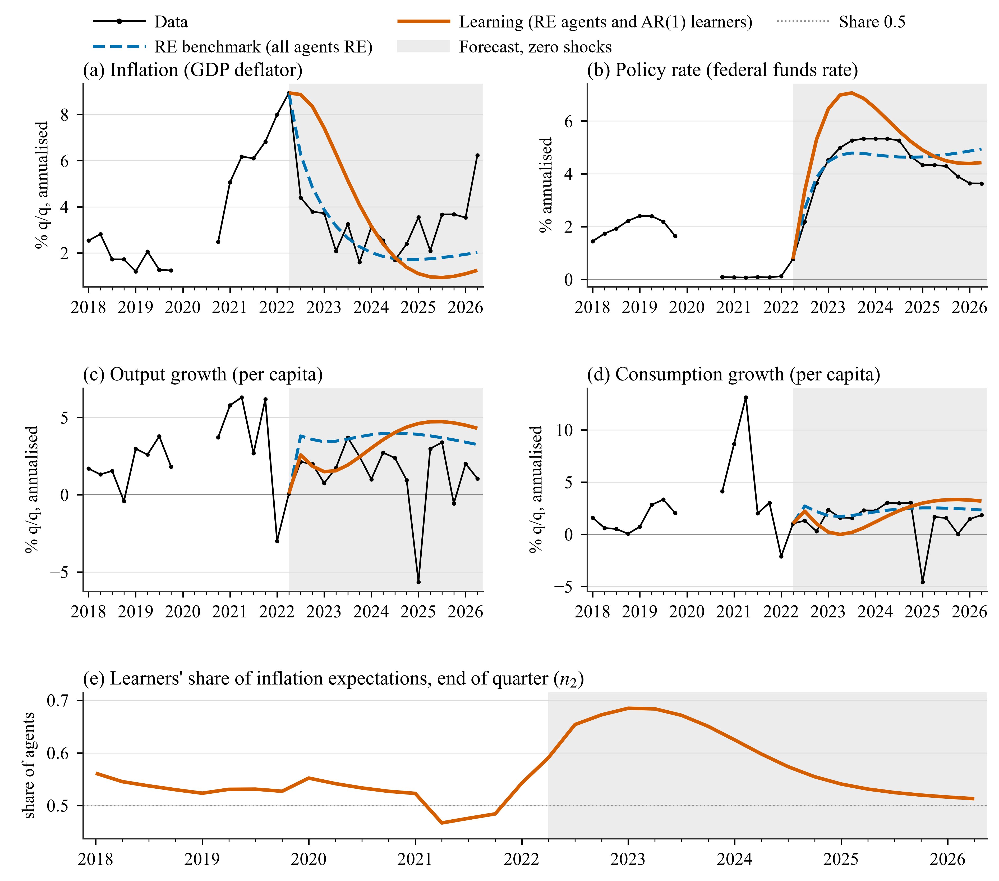

# hetlearn: heterogeneous expectations for IRIS models

> **Disclaimer.** This is a Claude-assisted project. The code, tests and documentation were
> developed with Anthropic's Claude, in particular Claude Opus 5.5, under the author's direction
> and review.

`hetlearn` is a MATLAB toolbox, built on the [IRIS Toolbox](https://github.com/IRIS-Solutions-Team/IRIS-Toolbox)
(release 20230622), for forecasts and policy scenarios in DSGE models where not everyone has
rational expectations. The expectations of chosen forward-looking variables are a mix of
**RE agents**, who use the rational-expectations solution, and **adaptive learners**, who
forecast from a simple perceived law of motion and update it by recursive least squares. The
shares of the two groups switch each quarter with their recent forecast errors, following
Özden (2025, *International Journal of Central Banking* 21(1)).

You bring a linear IRIS model file and a database. The toolbox writes the
heterogeneous-expectations version of the model, learns beliefs and shares over the history,
and runs your scenario forward one quarter at a time with beliefs and shares updating as it
goes. The project's main model is Smets and Wouters (2007) on US data 1965Q1-2026Q2.

**Documentation website:** <https://tolgaozden.net/iris_toolbox_learning/> (built from
[`docs_site/`](docs_site/) by [`.github/workflows/docs.yml`](.github/workflows/docs.yml); see
[Building the documentation](#13-building-the-documentation)).

**Licence:** MIT, see [`LICENSE`](LICENSE).

## Contents

1. [What it does](#1-what-it-does)
2. [Requirements](#2-requirements)
3. [Installation](#3-installation)
4. [Quick start](#4-quick-start)
5. [Example: Application 1, the 2022Q2 inflation peak](#5-example-application-1-the-2022q2-inflation-peak)
6. [The applications](#6-the-applications)
7. [Options at a glance](#7-options-at-a-glance)
8. [Further expectation rules](#8-further-expectation-rules)
9. [Your own model](#9-your-own-model)
10. [Documentation map](#10-documentation-map)
11. [Repository layout](#11-repository-layout)
12. [Tests](#12-tests)
13. [Building the documentation](#13-building-the-documentation)
14. [Citation](#14-citation)

## 1. What it does

| Area | Features |
|---|---|
| Expectations | Heterogeneous expectations for any subset of forward-looking variables; all-RE, all-learner, fixed-share and switching modes |
| RE agents | Anchored (pure-RE forecast) or model-consistent; information up to t or t-1 |
| Learners | AR(1), AR(2), AR(1) without constant, regressions on other variables, VAR(1) perceived laws of motion; derived regressors; data up to t or t-1 |
| Gains | Constant gain or the endogenous gain of Kostyshyna, Özden and Zhang (2024) |
| Initial beliefs | From the RE model's moments, OLS on a training sample, or your values |
| Switching | Discrete choice on discounted squared forecast errors, per variable or one share for several variables |
| Stability | Projection facility on the PLMs and the actual law of motion, on the actual law of motion only, or none |
| History | Learning on the RE-filtered or RE-smoothed history; the history backed out with the learning model (inversion); a time-varying Kalman filter with one-step errors and a log likelihood |
| Scenarios | Zero or smoothed shocks, added shocks, conditions that put a variable on a path with a shock adjusting |
| Policy | The model's own rule or Ramsey policy under commitment; a discounted policy loss for every run |
| Uncertainty | Density forecasts (normal or bootstrapped shocks), with learning re-run in every draw |
| Diagnostics | Shock decompositions with time-varying beliefs; recursive real-time forecast evaluation with Diebold-Mariano tests |
| Further rules | Seven bounded-rationality rules: cognitive discounting, myopia and anchoring, diagnostic expectations, target believers, intercept-only learners, mean-only learners, experience-based gain |

Every option is checked by name and value, and every result stores the options that made it.

## 2. Requirements

| Software | Version | Needed for |
|---|---|---|
| MATLAB | R2025a | everything |
| IRIS Toolbox | release 20230622 | model parsing, solution, filtering, simulation |
| Python 3 with pandas, matplotlib | recent | only the report and figure builders |
| MkDocs Material | `docs_site/requirements.txt` | only to build the documentation site |

No other MATLAB toolbox and no Dynare are needed.

## 3. Installation

1. **Clone** the repository:

   ```powershell
   git clone https://github.com/tolgaozden/iris_toolbox_learning.git
   ```

2. **Get IRIS 20230622** from the [IRIS releases page](https://github.com/IRIS-Solutions-Team/IRIS-Toolbox/releases)
   (tag `Release-20230622`) and unzip it anywhere. Do not add it to the path yourself.

3. **Tell `setup_paths` where IRIS is.** It uses the folder in the environment variable
   `HETLEARN_IRIS_DIR`, else a folder `IRIS-Toolbox-Release-20230622` next to the project
   folder. So either unzip IRIS beside `iris_toolbox_learning/`, or set the variable first:

   ```matlab
   setenv('HETLEARN_IRIS_DIR', 'C:\path\to\IRIS-Toolbox-Release-20230622')
   ```

4. **Start a session** from the project root:

   ```matlab
   setup_paths      % starts IRIS, adds toolbox/, the R2025a IRIS patch, config/ and scenarios/
   ```

5. **Check**: `res = hetlearn.run(a1_learn());` should end by writing `results/a1_learn/`. The
   first run of a model writes its generated files and RE filter cache to
   `models/sw07/generated/`, so it takes longer; later runs take 10-20 seconds.

Details: [Installation](https://tolgaozden.net/iris_toolbox_learning/getting-started/installation/)
([source](docs_site/getting-started/installation.md)).

## 4. Quick start

```matlab
setup_paths
res_re = hetlearn.run(a1_re());        % every agent rational
res    = hetlearn.run(a1_learn());     % RE agents and AR(1) inflation learners, switching shares

T = hetlearn.compare({'a1_re', 'a1_learn'}, {'pinfobs', 'robs'})   % levels and differences, model units

h = qq(2022, 3):qq(2026, 2);
mean(4*res.paths.pinfobs(h))           % average inflation, annualised: 3.45
res.learning.pinf.n2(qq(2022, 2))      % learners' share at the end of 2022Q2: 0.591

% change one assumption, without a new file
cfg = a1_learn();
cfg.id = 'a1_learn_chi1';
cfg.switching.intensity = 1;
res1 = hetlearn.run(cfg, 'save', false);
```

A scenario is a MATLAB function returning a partial option tree. Options merge as
`hetlearn.defaults()` < `config/master_options.m` < the scenario; a child scenario calls its
parent and changes only what differs. To run the project's groups and log them:
`run_applications('app1')`.

More: [Quick start](https://tolgaozden.net/iris_toolbox_learning/getting-started/quick-start/)
([source](docs_site/getting-started/quick-start.md)).

## 5. Example: Application 1, the 2022Q2 inflation peak

US inflation peaked in 2022Q2 at 8.9% annualised. With no further shocks, how fast does it
come down under rational expectations, and how fast when part of the population learns?

```matlab
% scenarios/sw07/app1_peak/a1_learn.m
function cfg = a1_learn()
cfg = sw07_learn();              % SW07, origin = the 2022Q2 peak, horizon 16, mode 'switching' on {'pinf'}
cfg.id = 'a1_learn';
cfg.compare_with = {'a1_re'};
end
```

The project baseline (`config/master_options.m`): published SW07 parameters, AR(1) learners on
inflation with the endogenous gain from 0.05, intensity of choice 2, memory 0.8, RE agents
(anchored) and learners on t-1 information, the RE-filtered history, projection facility on
the actual law of motion.



*Data (black), RE benchmark (blue, dashed) and learning economy (orange), annualised; panel e:
the learners' share of inflation expectations.*

| Average 2022Q3-2026Q2 (%) | Data | RE | Learning | Learning − RE |
|---|---:|---:|---:|---:|
| Inflation | 3.21 | 2.59 | 3.45 | +0.86 |
| Policy rate | 4.41 | 4.53 | 5.42 | +0.88 |
| Output growth | 1.44 | 3.69 | 3.39 | −0.29 |
| Consumption growth | 1.42 | 2.27 | 1.96 | −0.31 |

- The learning-minus-RE inflation gap peaks at +3.54 pp in 2023Q1; from 2024Q4 learning
  inflation is below the RE path (1.25% against 2.02% in 2026Q2).
- The learners' share is 0.591 at the end of 2022Q2 and peaks at 0.685 in 2023Q1. Their AR(1)
  coefficient at the origin is 1.061: after the 2021-22 surge they perceive inflation as
  explosive and extrapolate the peak.
- The projection facility never acts in this run.

The full walkthrough, with the scenario files, what happens inside a run, the output files, the
learners' history 1966-2026 and sensitivity runs:
[Application 1 tutorial](https://tolgaozden.net/iris_toolbox_learning/tutorial/application-1/)
([source](docs_site/tutorial/application-1.md)).

## 6. The applications

| Application | Question | Key result (baseline) | Page |
|---|---|---|---|
| 1. Peak forecast | Disinflation from 2022Q2 with zero shocks | inflation 3.45% learning vs 2.59% RE | [site](https://tolgaozden.net/iris_toolbox_learning/tutorial/application-1/), [source](docs_site/tutorial/application-1.md) |
| 2. Shock replay | Feed in the RE-smoothed shocks of 2022Q3-2026Q2 | RE replay = data; learning replay 4.64% vs 3.21% data | [site](https://tolgaozden.net/iris_toolbox_learning/applications/app2-replay/), [source](docs_site/applications/app2-replay.md) |
| 3. Policy deviations | Rate 100 bp below/above the rule for a year | inflation effect +0.72 pp (learning) vs +0.67 pp (RE); asymmetry 0.014 pp | [site](https://tolgaozden.net/iris_toolbox_learning/applications/app3-policy/), [source](docs_site/applications/app3-policy.md) |
| 4. Ramsey policy | Optimal policy under commitment vs the rule | 80-quarter loss 127.7 vs 230.1 (RE), 184.5 vs 359.4 (learning) | [site](https://tolgaozden.net/iris_toolbox_learning/applications/app4-ramsey/), [source](docs_site/applications/app4-ramsey.md) |
| 5. Density forecasts | 500 draws of mark-up or demand shocks | 90% inflation band 14.6 pp (learning) vs 4.8 pp (RE) with mark-up shocks | [site](https://tolgaozden.net/iris_toolbox_learning/applications/app5-density/), [source](docs_site/applications/app5-density.md) |
| 6. History | The history backed out with the learning model; decompositions; Kalman likelihood | learners' share 0.811 (inversion) vs 0.591 at 2022Q2; one-step inflation RMSE 0.309 vs 0.371 (RE) | [site](https://tolgaozden.net/iris_toolbox_learning/applications/app6-history/), [source](docs_site/applications/app6-history.md) |

```matlab
run_applications('app3')      % one group; 'all' runs every group and the evaluation (~3 hours)
```

## 7. Options at a glance

| Group | Main options | Page |
|---|---|---|
| Expectations | `expectations.mode`, `expectations.variables` | [site](https://tolgaozden.net/iris_toolbox_learning/options/expectations/), [source](docs_site/options/expectations.md) |
| RE agents | `expectations.re_variant`, `expectations.re_info` | [site](https://tolgaozden.net/iris_toolbox_learning/options/re-agents/), [source](docs_site/options/re-agents.md) |
| Timing and information | `beliefs.info`, `expectations.re_info`, `history.re_states`, `history.realtime` | [site](https://tolgaozden.net/iris_toolbox_learning/options/timing/), [source](docs_site/options/timing.md) |
| Perceived laws of motion | `beliefs.plm.default`, `.by_var`, `.derived`, `.var` | [site](https://tolgaozden.net/iris_toolbox_learning/options/plm/), [source](docs_site/options/plm.md) |
| Gains | `gain.rule`, `gain.value`, `gain.koz.*` | [site](https://tolgaozden.net/iris_toolbox_learning/options/gains/), [source](docs_site/options/gains.md) |
| Initial beliefs | `beliefs.init.*`, `beliefs.update`, `history.learn` | [site](https://tolgaozden.net/iris_toolbox_learning/options/initial-beliefs/), [source](docs_site/options/initial-beliefs.md) |
| Shares and switching | `shares.*`, `switching.*` | [site](https://tolgaozden.net/iris_toolbox_learning/options/switching/), [source](docs_site/options/switching.md) |
| Projection facility | `projection.facility` | [site](https://tolgaozden.net/iris_toolbox_learning/options/projection-facility/), [source](docs_site/options/projection-facility.md) |
| History modes | `history.mode`, `history.inversion.*`, `history.kalman.init` | [site](https://tolgaozden.net/iris_toolbox_learning/options/history-modes/), [source](docs_site/options/history-modes.md) |
| Forecasts, shocks, conditions | `forecast.*`, `shocks.*`, `conditions`, `compare_with`, `engine.*` | [site](https://tolgaozden.net/iris_toolbox_learning/options/forecasts-conditions/), [source](docs_site/options/forecasts-conditions.md) |
| Monetary policy | `policy.*` | [site](https://tolgaozden.net/iris_toolbox_learning/options/policy/), [source](docs_site/options/policy.md) |
| Density forecasts | `density.*` | [site](https://tolgaozden.net/iris_toolbox_learning/options/densities/), [source](docs_site/options/densities.md) |
| Shock decompositions | `hetlearn.decompose` | [site](https://tolgaozden.net/iris_toolbox_learning/options/decompositions/), [source](docs_site/options/decompositions.md) |
| Forecast evaluation | `hetlearn.evaluate`, `hetlearn.evaluate_tables` | [site](https://tolgaozden.net/iris_toolbox_learning/options/evaluation/), [source](docs_site/options/evaluation.md) |
| Further expectation rules | `expectations.types`, `expectations.transforms`, `shares.init`, `shares.fixed` | [site](https://tolgaozden.net/iris_toolbox_learning/options/further-expectation-rules/), [source](docs_site/options/further-expectation-rules.md) |

Every option with its default: [Options reference](https://tolgaozden.net/iris_toolbox_learning/reference/options/)
([source](docs_site/reference/options.md)). `scenarios/sw07/base/sw07_re.m` lists every option
as a commented line.

## 8. Further expectation rules

Seven rules from the bounded-rationality literature, each a scenario in
`scenarios/sw07/br_portfolio/` that adds a few lines to `a1_learn`:

| Rule | Scenario | Average inflation 2022Q3-2026Q2 |
|---|---|---:|
| Cognitive discounting on the learning set, m = 0.94 | `br05b_cd_learn` | 4.09% |
| Myopia and anchoring in the price Phillips curve | `br07_myopia_anchoring` | 3.42% |
| Diagnostic expectations, θ = 0.44 | `br10_diagnostic` | 4.75% |
| Target believers beside RE agents and learners | `br19_target_believers` | 3.38% |
| Intercept-only learners with RE slopes | `br23_intercept_only` | 2.94% |
| Mean-only learners | `br24_mean_only` | 3.08% |
| Experience-based gain, 0.018 | `br26_experience` | 3.06% |

Example (target believers):

```matlab
cfg = a1_learn();
cfg.id = 'br19_target_believers';
cfg.expectations.types = {struct('name', 'RE', 'kind', 're'), struct('name', 'BR', 'kind', 'plm'), ...
    struct('name', 'TB', 'kind', 'rule', 'rule', '0')};
cfg.shares.init = struct('RE', 1/3, 'BR', 1/3, 'TB', 1/3);
res = hetlearn.run(cfg);
```

Every rule with its code and results: [Further expectation rules](https://tolgaozden.net/iris_toolbox_learning/options/further-expectation-rules/)
([source](docs_site/options/further-expectation-rules.md)).

## 9. Your own model

Any linear IRIS model with leads (`x{+1}`) works. A model package is a folder
`models/<name>/` with the model file, a parameter function, a database and a `model_spec.m`
contract; then:

```matlab
spec = hetlearn.load_spec('<name>');
cfg = struct('model', '<name>');
cfg.expectations.variables = {'pinf'};
opts = hetlearn.load_options(cfg, struct());
[m, info] = hetlearn.load_model(spec, opts);   % writes the extended model, runs the collapse test
info.meta.forward_vars                         % the variables that can learn
```

Step by step: [Your own model](https://tolgaozden.net/iris_toolbox_learning/your-own-model/)
([source](docs_site/your-own-model.md)).

## 10. Documentation map

| Page | Website | Source |
|---|---|---|
| Home | [site](https://tolgaozden.net/iris_toolbox_learning/) | [docs_site/index.md](docs_site/index.md) |
| Installation | [site](https://tolgaozden.net/iris_toolbox_learning/getting-started/installation/) | [source](docs_site/getting-started/installation.md) |
| Quick start | [site](https://tolgaozden.net/iris_toolbox_learning/getting-started/quick-start/) | [source](docs_site/getting-started/quick-start.md) |
| Application 1 tutorial | [site](https://tolgaozden.net/iris_toolbox_learning/tutorial/application-1/) | [source](docs_site/tutorial/application-1.md) |
| Applications overview | [site](https://tolgaozden.net/iris_toolbox_learning/applications/) | [source](docs_site/applications/index.md) |
| Applications 2-6 | [2](https://tolgaozden.net/iris_toolbox_learning/applications/app2-replay/), [3](https://tolgaozden.net/iris_toolbox_learning/applications/app3-policy/), [4](https://tolgaozden.net/iris_toolbox_learning/applications/app4-ramsey/), [5](https://tolgaozden.net/iris_toolbox_learning/applications/app5-density/), [6](https://tolgaozden.net/iris_toolbox_learning/applications/app6-history/) | [docs_site/applications/](docs_site/applications/) |
| Options overview | [site](https://tolgaozden.net/iris_toolbox_learning/options/) | [source](docs_site/options/index.md) |
| Option pages | [section 7](#7-options-at-a-glance) | [docs_site/options/](docs_site/options/) |
| Your own model | [site](https://tolgaozden.net/iris_toolbox_learning/your-own-model/) | [source](docs_site/your-own-model.md) |
| Options reference | [site](https://tolgaozden.net/iris_toolbox_learning/reference/options/) | [source](docs_site/reference/options.md) |
| Functions and outputs | [site](https://tolgaozden.net/iris_toolbox_learning/reference/functions-outputs/) | [source](docs_site/reference/functions-outputs.md) |
| Technical appendix | [site](https://tolgaozden.net/iris_toolbox_learning/reference/technical-appendix/) | [docs/technical_appendix/](docs/technical_appendix/) |
| FAQ and troubleshooting | [site](https://tolgaozden.net/iris_toolbox_learning/help/faq/) | [source](docs_site/help/faq.md) |

Other documents in the repository:

| Document | Content |
|---|---|
| [docs/technical_appendix/](docs/technical_appendix/) | The methods: equations, timing conventions, algorithms |
| [docs/USER_GUIDE.md](docs/USER_GUIDE.md) | The full user guide: every option with its checks, where each assumption lives, outputs, practical notes |
| [docs/DESIGN.md](docs/DESIGN.md) | Design specification of the toolbox |
| [docs/DESIGN_br_extensions.md](docs/DESIGN_br_extensions.md) | Design of the agent types, transforms and the Kalman history |
| [docs/FEATURES.md](docs/FEATURES.md) | Feature register |
| [README_PIPELINE.md](README_PIPELINE.md) | Internal pipeline map: every step, its inputs and outputs, status and log |

## 11. Repository layout

```
setup_paths.m              IRIS and project paths (IRIS: HETLEARN_IRIS_DIR or a sibling folder)
run_applications.m         runner for the SW07 applications, model variants and evaluation
run_br_app1.m              the seven further rules in Application 1
run_br_portfolio.m         their impulse responses and Kalman RMSE
config/master_options.m    project-wide option values (the baseline)
toolbox/+hetlearn/         the toolbox
toolbox/iris_patches/      a fixed copy of one IRIS file for MATLAB R2025a
models/sw07/               Smets-Wouters (2007): model, two parameter sets, data, spec, validation
models/ijcb3/, models/as07/  two smaller packages, kept as templates
scenarios/sw07/            scenario files: base/, app1_peak/ ... app6_history/, var1-var4, eval/, br_portfolio/
results/summary_v3/        summary script and memo (the CSVs are rebuilt, not versioned)
reports/                   HTML report builders (Python)
paper/figures/             paper figures and their builder
tests/                     test suites, toy NK package, test models, reference results
docs/                      user guide, design notes, feature register, technical appendix
docs_site/                 the documentation website (MkDocs)
```

Not versioned (`.gitignore`): `results/` except the summary scripts and memo, every
`generated/` folder, `tests/output/`, `reports/*.html` and `archive/`. A fresh clone rebuilds
them by running the pipeline.

## 12. Tests

```matlab
addpath(fullfile(pwd, 'tests'))
run_tests({'test_options', 'test_rls', 'test_switching'})   % a subset, seconds
run_tests()                                                  % every suite, more than 9 minutes
```

The 24 suites (listed in `tests/run_tests.m`; 364 checks, all passing on 2026-10-22) cover options, RLS, switching, PLMs, the model
generator, the engine, SW07, density forecasts, evaluation, anchored RE, the inversion,
decompositions, Ramsey policy, information timing, the endogenous gain, the projection
facility, RE states and information, the Kalman history, agent types, transforms, the
generalised anchor, and a frozen regression gate. Several checks compare against references
made with Dynare or hand-written models. The tests use their own option file
(`tests/scenarios/master_options.m`, the toolbox defaults), not the project baseline; run them
in a separate MATLAB session and at the default thread count (exact-reference checks differ by
about 1e-12 with fewer threads).

## 13. Building the documentation

```powershell
pip install -r docs_site/requirements.txt
mkdocs serve                  # local preview at http://127.0.0.1:8000
mkdocs build --strict         # static site in site/
```

`.github/workflows/docs.yml` builds the site with `--strict` and deploys it to GitHub Pages on
every push to `main` that changes `docs_site/`, `mkdocs.yml` or the workflow. It needs
**Settings > Pages > Source: GitHub Actions** in the repository (set). The site is published at
https://tolgaozden.net/iris_toolbox_learning/.

The figures in `docs_site/assets/figures/` are copies of `paper/figures/fig_*.png`
(`python paper/figures/make_figures.py`); copy them again when the figures change.

## 14. Citation

If you use the toolbox, please cite the method and the toolbox:

```bibtex
@article{ozden2025hetexp,
  author  = {{\"O}zden, Tolga},
  title   = {Heterogeneous Expectations and the Business Cycle},
  journal = {International Journal of Central Banking},
  volume  = {21},
  number  = {1},
  year    = {2025}
}

@misc{hetlearn,
  author       = {{\"O}zden, Tolga},
  title        = {hetlearn: a {MATLAB} toolbox for heterogeneous expectations in {IRIS} models},
  year         = {2026},
  howpublished = {\url{https://github.com/tolgaozden/iris_toolbox_learning}}
}
```

Related references: Kostyshyna, O., T. Özden and Y. Zhang (2024), Bank of Canada Staff Working
Paper 2024-14 (endogenous gain); Smets, F. and R. Wouters (2007), *American Economic Review*
97(3), 586-606; the IRIS Toolbox, <https://github.com/IRIS-Solutions-Team/IRIS-Toolbox>.
