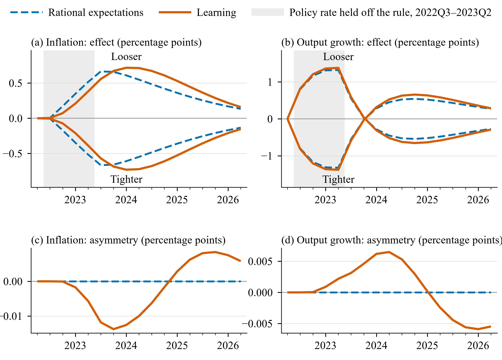

# Application 3: policy 100 basis points looser or tighter than the rule

**Question.** From the 2022Q2 peak, the central bank sets the policy rate 100 basis points (bp)
a year below (looser) or above (tighter) what its Taylor rule prescribes, for the four quarters
2022Q3-2023Q2. How do inflation and output respond, and does learning make the responses
asymmetric?

## How the deviation is set: a condition

The policy rule of the Smets and Wouters (2007) model (SW07) is `r = (rule terms) + ms`, where
`ms` is the AR(1) monetary shock process driven by the shock `em`. The scenario puts `ms` on a
path and lets `em` adjust each quarter to deliver it:

```matlab
function cfg = a3_loose_re()
cfg = a1_re();
cfg.id = 'a3_loose_re';
cfg.title = 'App 3: policy 100 bp looser than the Taylor rule in 2022Q3-2023Q2, rational expectations';
cfg.conditions = struct('variable', 'ms', 'shock', 'em', ...
    'dates', [qq(2022, 3), qq(2023, 2)], 'values', -0.25, ...
    'type', 'delta', 'reference', 'self');
cfg.compare_with = {'a1_re'};
end
```

- `type = 'delta'` with `reference = 'self'`: `ms` is held 0.25 below its path in the same
  scenario without the condition. The model is in percent per quarter, so 0.25 is 100 bp a
  year.
- `dates` with two elements is read as a range: 2022Q3 to 2023Q2.
- `em` is endogenized quarter by quarter, so the deviation surprises agents every quarter.

The tighter scenario changes only the sign; the learning scenarios copy the condition:

```matlab
function cfg = a3_tight_re()
cfg = a3_loose_re();
cfg.id = 'a3_tight_re';
cfg.conditions.values = 0.25;
end

function cfg = a3_loose_learn()
cfg = a1_learn();
c = a3_loose_re();
cfg.id = 'a3_loose_learn';
cfg.conditions = c.conditions;          % the same condition as the RE run
cfg.compare_with = {'a1_learn'};
end

function cfg = a3_tight_learn()
cfg = a3_loose_learn();
cfg.id = 'a3_tight_learn';
cfg.conditions.values = 0.25;
end
```

```matlab
run_applications('app3')
```

## Results

{ .figure }

*Deviations from Application 1 (percentage points (pp) of annualized rates) when the rate is
held 100 bp a year below or above the Taylor rule in 2022Q3-2023Q2 (shaded). Top: inflation
and output growth. Bottom: looser + tighter, which is zero when the responses are symmetric.*

Effects under rational expectations (RE) and learning, in pp (the share as a fraction):

| Variable | Statistic | RE, looser | Learning, looser | Learning, tighter | Looser + tighter |
|---|---|---:|---:|---:|---:|
| Inflation | largest effect | +0.666 (2023Q3) | +0.717 (2024Q1) | −0.730 (2024Q1) | −0.0138 (2023Q4) |
| | average effect | +0.366 | +0.413 | −0.415 | −0.0015 |
| Output growth | largest effect | +1.322 (2023Q2) | +1.382 (2023Q2) | −1.380 (2023Q2) | +0.0065 (2024Q2) |
| Policy rate | largest effect | −1.735 (2023Q2) | −1.817 (2023Q2) | +1.815 (2023Q2) | −0.0099 (2024Q2) |
| Learners' share in force | largest effect | | +0.0244 (2024Q3) | −0.0295 (2024Q2) | −0.0053 (2024Q2) |

Learning delays the inflation response and makes it slightly larger: the peak effect of looser
policy is +0.72 pp in 2024Q1 against +0.67 pp in 2023Q3 under RE. The policy-rate effect
includes the rule's own response to the higher or lower inflation.

The asymmetry is small, at most 0.014 pp of inflation, about 2% of the effect. Under RE the two
responses are exact mirror images, to 6e-14. Under learning the asymmetry comes from the
learning states: looser policy raises the learners' share in force by up to 0.024, and tighter
policy lowers it by up to 0.030.

## Variations

```matlab
% 50 bp a year instead of 100 bp
cfg = a3_loose_learn(); cfg.id = 'a3_loose50_learn'; cfg.conditions.values = -0.125;
hetlearn.run(cfg);

% Put the observed policy rate itself on a path (level condition, % per quarter)
cfg = a1_learn(); cfg.id = 'a3_path_learn';
cfg.conditions = struct('variable', 'robs', 'shock', 'em', ...
    'dates', qq(2022, 3):qq(2023, 2), 'values', [0.5 0.8 1.1 1.2], ...
    'type', 'level', 'reference', 'self');
hetlearn.run(cfg);
```

More on conditions: [Forecasts, shocks and conditions](../options/forecasts-conditions.md#conditions).
