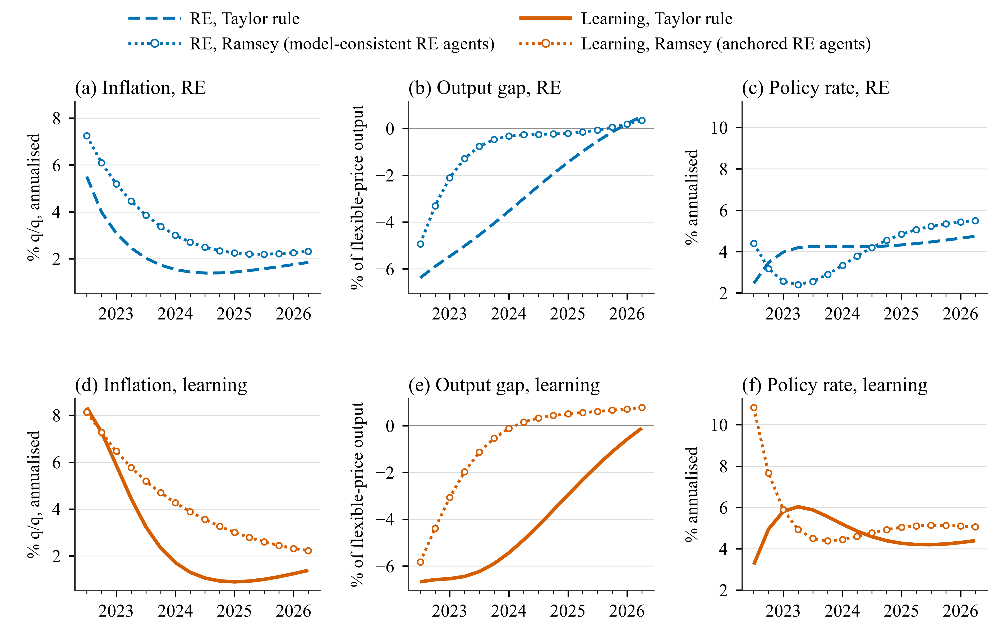

# Application 4: Ramsey policy against the Taylor rule

**Question.** From the 2022Q2 peak, what would optimal policy under commitment do instead of
the Taylor rule, under rational expectations (RE) and with learners, for four sets of loss
weights?

## The loss

Every run of a model package with a policy section reports a discounted loss with the
weights of `policy.loss`:

\[
L = \sum_{h=1}^{H} \delta^{h}\left(\hat\pi_h^2 + \lambda_y x_h^2 + \lambda_r \hat r_h^2
+ \lambda_{\Delta r}(\Delta \hat r_h)^2\right),
\]

where for the Smets and Wouters (2007) model (SW07) \(\hat\pi = 4\pi\) and \(\hat r = 4r\) are
annualized deviations from the steady state, \(x = y - y^f\) is the output gap and
\(\delta = \bar\beta\gamma\) is the discount of the SW07 Phillips curve. The targets come from
`spec.policy.targets` in `models/sw07/model_spec.m`:

```matlab
spec.policy = struct( ...
    'instrument', 'r', ...
    'rule_label', 'Monetary policy rule, Taylor rule on the output gap y-yf', ...
    'targets', struct('pinf', '4*pinf', 'ygap', 'y - yf', 'r', '4*r', 'dr', '4*(r - r{-1})'), ...
    'discount', '$cbetabar$*$cgamma$');
```

## Scenario files

`scenarios/sw07/app4_ramsey/` has 14 files. The rule runs report the loss over 80 quarters
(the forecast continued with zero shocks):

```matlab
function cfg = a4_rule_re()
cfg = a1_re();
cfg.id = 'a4_rule_re';
cfg.policy.loss_horizon = 80;
cfg.expectations.re_info = 'current';   % Ramsey policy needs period-t RE information
end
```

Every app-4 file sets period-t RE information, the project's only deviation from its
baseline. The Ramsey runs switch the rule off and set the weights:

```matlab
function cfg = a4_ramsey_balanced_re()
cfg = a4_rule_re();
cfg.id = 'a4_ramsey_balanced_re';
cfg.policy.mode = 'ramsey';
cfg.policy.type = 'commitment';
cfg.policy.loss = struct('pinf', 1, 'ygap', 0.5, 'r', 0.1, 'dr', 0);
cfg.compare_with = {'a4_rule_re'};
end
```

| Weight set | `policy.loss` |
|---|---|
| balanced | `struct('pinf', 1, 'ygap', 0.5, 'r', 0.1, 'dr', 0)` |
| hawk | `struct('pinf', 1, 'ygap', 0.1, 'r', 0.1, 'dr', 0)` |
| dove | `struct('pinf', 1, 'ygap', 1, 'r', 0.1, 'dr', 0)` |
| smooth | `struct('pinf', 1, 'ygap', 0.5, 'r', 0.1, 'dr', 0.5)` |

Each weight set has three files: `_re` (anchored RE agents), `_re_mc` (model-consistent RE
agents, `cfg.expectations.re_variant = 'model_consistent'`: the RE Ramsey benchmark) and
`_learn` (copies the policy block of the `_re` file into `a4_rule_learn`).

```matlab
run_applications('app4')      % about 2.5 minutes
```

!!! warning "The RE benchmark"
    Anchored RE agents keep the Taylor-rule forecast under a Ramsey plan, so the `_re_mc` runs
    are the RE benchmark and the learning Ramsey loss is not a clean gain from optimal policy
    ([Monetary policy](../options/policy.md#anchored-re-agents-and-ramsey-policy)).

## Results

{ .figure }

*Ramsey policy under commitment (dotted) against the Taylor rule, balanced weights, zero
shocks. Inflation, output gap and policy rate; top row RE (`a4_ramsey_balanced_re_mc`), bottom
row learning (`a4_ramsey_balanced_learn`).*

Discounted loss over 80 quarters:

| Weights | RE rule | RE Ramsey | Ratio | Learning rule | Learning Ramsey | Ratio |
|---|---:|---:|---:|---:|---:|---:|
| balanced | 230.1 | 127.7 | 0.56 | 359.4 | 184.5 | 0.51 |
| hawk | 104.9 | 51.5 | 0.49 | 175.4 | 94.6 | 0.54 |
| dove | 386.6 | 196.2 | 0.51 | 589.4 | 234.2 | 0.40 |
| smooth | 232.2 | 129.6 | 0.56 | 364.6 | 201.0 | 0.55 |

Balanced weights, averages 2022Q3-2026Q2:

| | RE rule | RE Ramsey | Learning rule | Learning Ramsey |
|---|---:|---:|---:|---:|
| Inflation (%) | 2.14 | 3.39 | 2.69 | 4.24 |
| Output gap (%) | −2.79 | −0.86 | −4.08 | −0.77 |
| Policy rate (%) | 4.17 | 4.08 | 4.75 | 5.47 |

- Ramsey policy roughly halves the loss under both expectation regimes.
- It trades a slower fall in inflation for a much smaller output gap.
- With learners the planner raises the rate sharply at the start: 10.83% in 2022Q3 against
  3.24% under the rule (RE: 4.40% against 2.46%).
- Under learning the planner treats the current beliefs and shares as permanent and
  re-optimizes every quarter, honoring past commitments.

Each run also writes `results/<id>/loss.csv` with the contribution of each target.

## Variations

```matlab
% Another weight set
cfg = a4_ramsey_balanced_learn(); cfg.id = 'a4_ramsey_strict_learn';
cfg.policy.loss = struct('pinf', 1, 'ygap', 0.25, 'r', 0.1, 'dr', 0);
hetlearn.run(cfg);

% Another discount factor and the loss over the 16-quarter horizon only
cfg = a4_ramsey_balanced_re_mc(); cfg.id = 'a4_bal_mc_disc';
cfg.policy.discount = 0.99;
cfg.policy.loss_horizon = [];        % [] = forecast.horizon
hetlearn.run(cfg);
```

`policy.loss` is replaced as a whole: a target left out gets weight 0. All options:
[Monetary policy](../options/policy.md).
