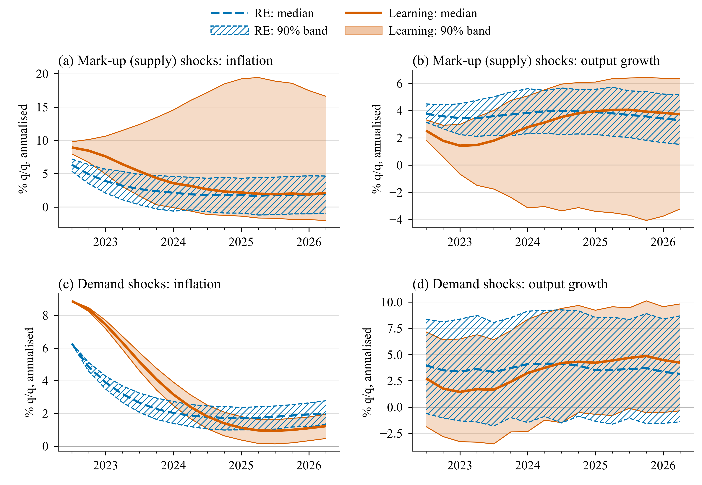

# Application 5: density forecasts

**Question.** Application 1 assumes zero shocks. How wide is the range of outcomes when
supply (mark-up) or demand shocks keep hitting the economy, and does learning change it?

## Scenario files

`scenarios/sw07/app5_density/`:

```matlab
function cfg = a5_markup_re()
cfg = a1_re();
cfg.id = 'a5_markup_re';
cfg.density.enabled = true;
cfg.density.shocks = {'epinf', 'ew'};      % price and wage mark-up shocks
cfg.density.sigma = 'calibrated';         % the model's std_<shock>
cfg.density.method = 'normal';
cfg.density.ndraws = 500;
cfg.density.seed = 0;
end

function cfg = a5_demand_re()
cfg = a5_markup_re();
cfg.id = 'a5_demand_re';
cfg.density.shocks = {'eb', 'eg', 'eqs'};  % risk premium, government spending, investment
end

function cfg = a5_markup_learn()
cfg = a1_learn();
d = a5_markup_re();
cfg.id = 'a5_markup_learn';
cfg.density = d.density;                   % the same draws as the RE run
cfg.compare_with = {'a5_markup_re'};
end
```

`a5_demand_learn` copies the density block of `a5_demand_re` the same way.

Each draw adds random shocks on top of the scenario (here, zero shocks) in every forecast
quarter. A rational expectations (RE) density without conditions takes a fast path: one linear
simulation per draw (about 30 seconds for 500 draws). A learning density re-runs the
quarter-by-quarter forecast for each draw, so beliefs and shares respond to the drawn shocks
(about 0.5-0.7 seconds per draw).

```matlab
run_applications('app5')        % about 14 minutes
```

Outputs, besides the usual files: `results/<id>/density.mat`, `density_quantiles.csv`
(variable, date, quantile, value in model and report units) and `density_events.csv` (one row
per draw: status and facility events).

## Results

{ .figure }

*90% bands (5th-95th percentiles) and medians of 500 forecasts from the 2022Q2 peak. Top:
mark-up shocks; bottom: demand shocks. RE band hatched, learning band filled.*

Band widths in percentage points (pp):

| Shocks | Variable | Average 90% band width, RE (pp) | Learning (pp) |
|---|---|---:|---:|
| Mark-up (`epinf`, `ew`) | inflation | 4.76 | 14.59 |
| | output growth | 3.02 | 7.51 |
| | policy rate | 2.85 | 10.71 |
| Demand (`eb`, `eg`, `eqs`) | inflation | 1.18 | 1.16 |
| | output growth | 9.92 | 10.03 |

With mark-up shocks learning triples the inflation
band, and the learning distribution is skewed upward: inflation shocks feed the learners'
explosive AR(1) beliefs (\(\beta = 1.061\) at the origin) and their share. In 2026Q2 the
learning band runs from −2.0% to 16.6% (RE: −1.0% to 4.6%). With demand shocks the bands are
about the same under learning and RE, because these shocks move inflation little.

The projection facility matters in the tail. It acts in 23 of the 500 learning mark-up draws
(46 quarters with beliefs reverted, 13 with shares kept) and in none of the demand draws. All
draws are used.

## Variations

```matlab
% Shock standard deviations from the RE-smoothed shocks of 1966-2019
cfg = a5_markup_learn(); cfg.id = 'a5_markup_learn_sm';
cfg.density.sigma = 'smoothed';
cfg.density.sigma_range = [qq(1966, 1), qq(2019, 4)];
hetlearn.run(cfg);

% Bootstrap whole quarters of smoothed shocks, 200 draws, keep every draw
cfg = a5_markup_learn(); cfg.id = 'a5_markup_learn_bs';
cfg.density.method = 'bootstrap';
cfg.density.demean = true;
cfg.density.ndraws = 200;
cfg.density.keep_draws = true;
hetlearn.run(cfg);
```

All density options: [Density forecasts](../options/densities.md).
