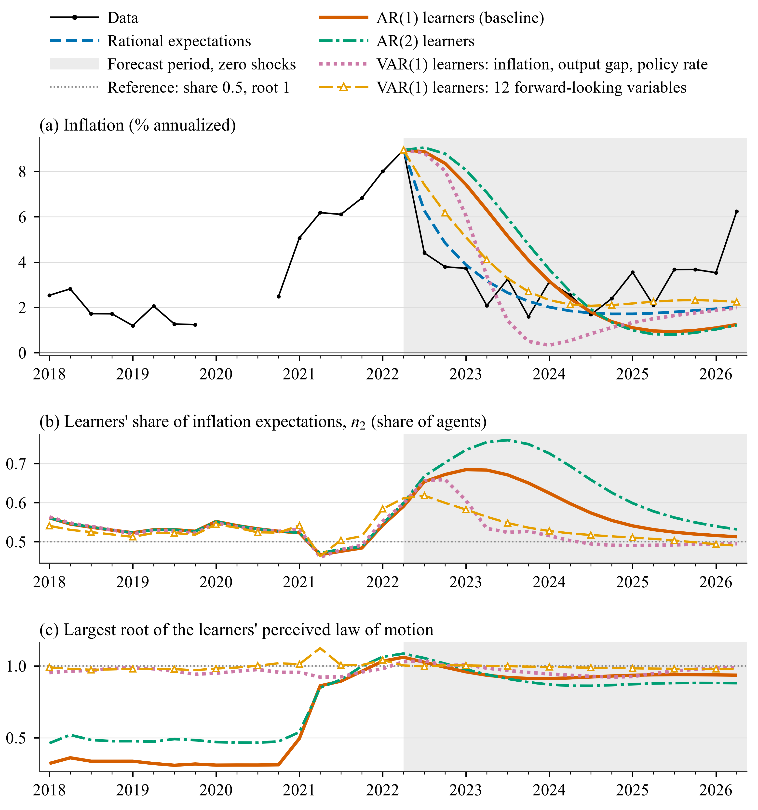

# Perceived laws of motion (PLMs)

A perceived law of motion (PLM) is the learners' forecasting model: a linear regression of a
variable on lags of itself or of other variables, whose coefficients they re-estimate each
quarter by recursive least squares.

| Option | Values (default first) | Meaning |
|---|---|---|
| `beliefs.plm.default` | `'ar1'`, `'ar2'`, `'ar1_noconst'`, `'var1'` | PLM of every learning variable without its own entry; `'var1'` = one vector autoregression, VAR(1), over the learning set |
| `beliefs.plm.by_var.<x>` | a shorthand (`'ar1'`, `'ar2'`, `'ar1_noconst'`) or `struct('regressors', {...}, 'constant', true)` | PLM of one variable. An entry for a variable that does not learn sets its auxiliary PLM |
| `beliefs.plm.derived.<name>` | text | A regressor defined as a linear expression in model variables, e.g. `'y - yf'`; it becomes a model variable |
| `beliefs.plm.var` | `struct('variables', {{}}, 'lags', 1, 'constant', true)` | A VAR PLM over a cellstr of variables or `'learning'` (the learning set) |

## How a PLM forecasts

A PLM equation for variable \(v\) is

\[
v_t = \alpha_v + \sum_j \beta_{v,j}\, u_{j,t-l_j} + e_{v,t}, \qquad l_j \ge 1 ,
\]

with \(e_{v,t}\) the PLM error. With `beliefs.info = 'lagged'` the learners see data up to t-1,
so for the one-step-ahead forecast of \(x_{t+1}\) they iterate the PLMs forward from t-1,
replacing every unobserved regressor by its own PLM forecast. For the AR(1):
\(\alpha + \beta(\alpha + \beta x_{t-1})\). With `'current'` they iterate from t:
\(\alpha + \beta x_t\).

Belief parameters are named after the PLM: `alpha_<x>` and `beta_<x>` for an AR(1) with a
constant; `alpha_<x>` and `beta_<x>__<u>_l<lag>` for anything else (for example
`beta_pinf__ygap_l1`). They appear under these names in `res.learning.<x>` and
`learning.csv`.

## Examples

```matlab
% AR(2) learners (model variant v2_ar2)
cfg = a1_learn(); cfg.id = 'v2_ar2';
cfg.beliefs.plm.default = 'ar2';

% AR(1) without constant: only the persistence is learned (v2_ar1nc)
cfg = a1_learn(); cfg.id = 'v2_ar1nc';
cfg.beliefs.plm.default = 'ar1_noconst';

% Inflation on lagged inflation, output gap and policy rate (v2_reg)
cfg = a1_learn(); cfg.id = 'v2_reg';
cfg.beliefs.plm.derived.ygap = 'y - yf';
cfg.beliefs.plm.by_var.pinf = struct('regressors', {{'pinf{-1}', 'ygap{-1}', 'r{-1}'}}, 'constant', true);

% VAR(1) in inflation, output gap and policy rate (v2_var3)
cfg = a1_learn(); cfg.id = 'v2_var3';
cfg.beliefs.plm.derived.ygap = 'y - yf';
cfg.beliefs.plm.var = struct('variables', {{'pinf', 'ygap', 'r'}}, 'lags', 1, 'constant', true);

% VAR(1) in the 12 forward-looking variables of SW07 (v2_var12)
cfg = a1_learn(); cfg.id = 'v2_var12';
cfg.beliefs.plm.var = struct('variables', ...
    {{'invef', 'rkf', 'pkf', 'cf', 'labf', 'inve', 'pinf', 'rk', 'pk', 'c', 'lab', 'w'}}, ...
    'lags', 1, 'constant', true);

% One PLM per variable with a shorthand
cfg = a1_learn(); cfg.id = 'a1_byvar_ar2';
cfg.beliefs.plm.by_var.pinf = 'ar2';

% Mean-only PLM: the forecast is the learned mean (adaptive expectations)
cfg = a1_learn(); cfg.id = 'a1_mean_only';
cfg.beliefs.plm.by_var.pinf = struct('regressors', {{}}, 'constant', true);
```

Each of them runs with `hetlearn.run(cfg)`.

## Rules

- **Regressors are lags.** They are written as `name{-k}` with k >= 1.
- **Auxiliary PLMs.** A regressor that is not itself a learning variable gets an auxiliary PLM
  (an AR(1) with constant by default), learned by the same recursive least squares, so the
  learners can iterate the system forward. In `v2_reg`, `ygap` and `r` get auxiliary AR(1)s.
  A `by_var` entry for that variable sets its auxiliary PLM.
- **VARs.** VAR members that do not learn become auxiliary VAR equations; only the learning
  variables' expectations use the VAR forecast. VAR members take no `by_var` entry.
- **`'var1'`** builds a VAR(1) over the whole learning set. It cannot be combined with
  `beliefs.plm.var.variables` (an error).
- **Derived regressors** must be linear expressions in model variables; each becomes a model
  variable with that definition.
- **Blocks.** PLM equations linked through their regressors form a block (a VAR is one block;
  separate AR(1)s are separate blocks). The projection facility `'plm_alm'` judges each block
  by its largest root.
- **Generated files.** The default AR(1) PLM uses `generated/<name>_ext_ar1.model`; any other
  PLM spec gets its own file, tagged with a hash of the spec (`<name>_ext_p<8 hex>.model`), and
  its own rational expectations (RE) filter cache.

## In the project

Model variant 2 runs Application 1 with each PLM in the Smets and Wouters (2007) model (SW07).
Averages over 2022Q3-2026Q2:

| PLM for inflation | Scenario | Inflation (%) | Rate (%) | Output growth (%) | Share 2022Q2 | Peak share | Largest root 2022Q2 | Mean root 1966-2022 |
|---|---|---:|---:|---:|---:|---:|---:|---:|
| RE benchmark | `a1_re` | 2.59 | 4.53 | 3.69 | | | | |
| AR(1), baseline | `a1_learn` | 3.45 | 5.42 | 3.39 | 0.591 | 0.685 | 1.061 | 0.747 |
| AR(1), no constant | `v2_ar1nc` | 3.25 | 5.18 | 3.46 | 0.611 | 0.651 | 1.031 | 0.883 |
| AR(2) | `v2_ar2` | 3.69 | 5.63 | 3.29 | 0.599 | 0.760 | 1.086 | 0.806 |
| Regression on \(\pi, x, r\) | `v2_reg` | 2.56 | 4.51 | 3.78 | 0.601 | 0.664 | 1.039 | 0.985 |
| VAR(1) in \(\pi, x, r\) | `v2_var3` | 2.57 | 4.53 | 3.77 | 0.598 | 0.659 | 1.030 | 0.953 |
| VAR(1) in 12 variables | `v2_var12` | 3.19 | 5.09 | 3.46 | 0.611 | 0.618 | 1.004 | 0.998 |

{ .figure }

*Inflation, the learners' share and the largest root of the PLM, four PLMs; the reference line
marks a root of 1.*

Every PLM has a largest root at or above 1 at the 2022Q2 origin, so none has a finite
perceived mean there. PLMs that include the output gap and the policy rate (`v2_reg`,
`v2_var3`) bring inflation down about as fast as RE; AR PLMs, which see only past inflation,
keep it higher for longer. The VAR learners perceive inflation as close to a unit root over the
whole history (mean root 0.95-1.00). No projection-facility event occurs in any of these runs.
