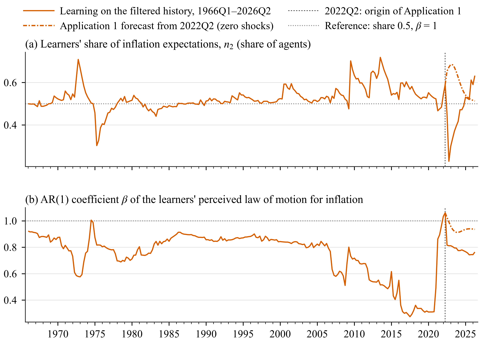

# Application 1: forecast from the 2022Q2 inflation peak

This is the main tutorial. It takes one question through the whole toolbox: the scenario
files, the run, what happens inside it, the output files, and the results with the figures
and numbers of the project's baseline (results of 2026-10-21, `results/summary_v3/`).

**The question.** US inflation (GDP deflator) peaked in 2022Q2 at 8.9% annualised. Suppose
that from that quarter on no further shocks hit the economy. How fast does inflation come
down if every agent has rational expectations, and how fast if part of the population forms
inflation expectations by adaptive learning, with the share of learners moving with recent
forecast performance?

!!! abstract "Result in one line"
    With learners, average inflation over 2022Q3-2026Q2 is **3.45%** against **2.59%** under
    rational expectations. The gap peaks at **+3.54 pp** in 2023Q1. The learners' share of
    inflation expectations is **0.591** at the origin and rises to **0.685** in 2023Q1,
    because the learners' perceived persistence of inflation is above one at the peak
    (AR(1) coefficient **1.061**).

## 1. The model and the data

The model package is `models/sw07/`: the Smets and Wouters (2007) model, log-linear, seven
shocks, seven US observables (output, consumption and investment growth, real wage growth,
hours, inflation, the federal funds rate). The project baseline uses the published SW07
posterior mode for 1966Q1-2004Q4 (`models/sw07/sw07_params_original.m`). The database runs
from 1965Q1 to 2026Q2 (FRED vintage 2026-09-29); every observable is treated as missing in
2020Q1-2020Q3, so the Kalman filter skips the covid quarters.

SW07 has twelve forward-looking variables. In Application 1 only inflation, `pinf`, has
heterogeneous expectations; every other expectation stays rational.

## 2. Expectations in the learning economy

The toolbox replaces every one-step expectation of a learning variable by a weighted
average of two forecasts. For inflation, in quarter \(t\):

\[
\hat E_t \pi_{t+1} = n_{1,t-1}\, E^{RE}_t \pi_{t+1} + n_{2,t-1}\, E^{BR}_t \pi_{t+1},
\qquad n_{1,t-1} + n_{2,t-1} = 1 .
\]

The shares in force in \(t\) are those computed at the end of \(t-1\).

**RE agents** (anchored, information up to \(t-1\)) use the forecast of the pure-RE model in
which inflation expectations are formed with data up to \(t-1\): \(E^{RE}_t \pi_{t+1} =
E_{t-1}\pi_{t+1}\) in that RE model, evaluated at the current state.

**Learners** (BR agents) believe inflation follows an AR(1),
\(\pi_t = \alpha + \beta \pi_{t-1} + \varepsilon_t\), and see data up to \(t-1\), so they
iterate the PLM two steps ahead with the beliefs \(\phi_{t-1} = (\alpha_{t-1}, \beta_{t-1})'\):

\[
E^{BR}_t \pi_{t+1} = \alpha_{t-1} + \beta_{t-1}\left(\alpha_{t-1} + \beta_{t-1}\pi_{t-1}\right).
\]

After \(\pi_t\) is observed they update the beliefs by recursive least squares with gain
\(g_t\), with \(z_{t-1} = (1, \pi_{t-1})'\):

\[
R_t = R_{t-1} + g_t\left(z_{t-1}z_{t-1}' - R_{t-1}\right), \qquad
\phi_t = \phi_{t-1} + g_t R_t^{-1} z_{t-1}\left(\pi_t - \phi_{t-1}' z_{t-1}\right).
\]

The gain is endogenous (Kostyshyna, Özden and Zhang 2024, eq. 9): with \(e_t\) the signed
one-step PLM residual and \(P\) the projection on \([0.001, 0.25]\),

\[
\gamma_t = P\left[\gamma_{t-1} + \mu R^g_{t-1} e_t\right], \qquad
R^g_t = (1 - \gamma_{t-1}) R^g_{t-1} + e_t ,
\]

and the update at the end of \(t\) uses \(g_t = \gamma_{t-1}\), starting from \(\gamma = 0.05\)
with \(\mu = 0.001\).

**Shares** follow the discrete choice of Özden (2025, eqs. 14-15). Each type's fitness is a
discounted sum of its past squared forecast errors, and the share of learners is a logit in
the two fitness values:

\[
U^i_t = \omega U^i_{t-1} - (1 - \omega)\left(\pi_t - F^i_{t-1}\right)^2, \qquad i \in \{RE, BR\},
\]

\[
n_{2,t} = \frac{\exp(\chi U^{BR}_t)}{\exp(\chi U^{RE}_t) + \exp(\chi U^{BR}_t)},
\]

where \(F^i_{t-1}\) is type \(i\)'s forecast of \(\pi_t\) made in \(t-1\), errors are in percent
per quarter, \(\chi = 2\) is the intensity of choice and \(\omega = 0.8\) the memory.

**Stability.** Each quarter the model with the new beliefs and shares (the actual law of
motion, ALM) is solved. If it has no stable solution, the projection facility puts the
beliefs back to their values before the update (`projection.facility = 'alm'`). In
Application 1 this never happens.

## 3. The baseline settings

The settings above are the project baseline, set once in `config/master_options.m` so that
every scenario of the project inherits them:

```matlab
% config/master_options.m (excerpt)
o.model_params = 'sw07_params_original';   % published SW07 (2007) mode
o.gain.rule = 'koz';                       % endogenous gain, Kostyshyna, Ozden and Zhang (2024)
o.gain.value = 0.05;                       % start gain
o.switching.intensity = 2;                 % chi
o.switching.memory = 0.8;                  % omega
o.shares.init_n2 = 0.5;                    % initial share of learners
o.beliefs.plm.default = 'ar1';             % AR(1) PLM with constant
o.beliefs.info = 'lagged';                 % learners see data up to t-1
o.expectations.re_info = 'lagged';         % RE agents: E_{t-1} x_{t+1}
o.expectations.re_variant = 'anchored';    % RE agents use the pure-RE forecast
o.history.re_states = 'filtered';          % history from the one-sided RE filter
o.projection.facility = 'alm';             % facility on the actual law of motion
```

These values differ from the toolbox defaults in `hetlearn.defaults()` (constant gain 0.0585,
\(\chi = 0.51\), memory 0.6, period-t RE information, smoothed history, facility `'plm_alm'`).
A new project starts from the defaults; set your own baseline in your `master_options.m`.

## 4. Step 1: the scenario files

Every SW07 scenario descends from one parent, `scenarios/sw07/base/sw07_re.m`. It sets the
model, finds the inflation peak and fixes the horizon. It also lists every other option as a
commented line, so it doubles as a template:

```matlab
function cfg = sw07_re()
cfg = struct();
cfg.id = 'sw07_re';
cfg.title = 'Forecast from the 2022Q2 inflation peak, rational expectations';
cfg.model = 'sw07';                           % model package models/sw07/

% forecast origin: the quarter of peak inflation in 2020Q1-2024Q4
spec = hetlearn.load_spec(cfg.model);
db = hetlearn.load_database(spec);
origin = hetlearn.find_peak(db, 'pinfobs', qq(2020, 1), qq(2024, 4));
assert(hetlearn.util.date_eq(origin, qq(2022, 2)), ...
    'sw07_re: expected the inflation peak in 2022Q2, found %s.', char(dat2str(origin)));
cfg.forecast.origin = origin;                 % last quarter of data used
cfg.forecast.horizon = 16;                    % quarters: 2022Q3-2026Q2

cfg.expectations.mode = 'rational';           % every agent RE
cfg.expectations.variables = {'pinf'};        % inflation has the RE/BR block
% ... every other option, commented, at its inherited value
end
```

In mode `'rational'` the inflation block is in the model with an RE share of 1, so the run is
the RE model (with t-1 information for inflation, from the baseline). Beliefs and shares are
still tracked as diagnostics.

The learning parent switches the shares on:

```matlab
function cfg = sw07_learn()
cfg = sw07_re();
cfg.id = 'sw07_learn';
cfg.expectations.mode = 'switching';
cfg.compare_with = {'sw07_re'};
end
```

Application 1 is these two scenarios under their own names
(`scenarios/sw07/app1_peak/`):

```matlab
function cfg = a1_re()
cfg = sw07_re();
cfg.id = 'a1_re';
cfg.title = 'App 1: forecast from the 2022Q2 peak, rational expectations';
end

function cfg = a1_learn()
cfg = sw07_learn();
cfg.id = 'a1_learn';
cfg.title = 'App 1: forecast from the 2022Q2 peak, learning on inflation';
cfg.compare_with = {'a1_re'};                 % writes compare_a1_re.csv
end
```

`a1_learn` is the parent of every learning scenario in the other applications and the model
variants, so a change here reaches all of them.

## 5. Step 2: run

```matlab
setup_paths
run_applications('app1')         % a1_re, then a1_learn; one row each in results/run_log.csv
```

or, without the runner:

```matlab
res_re = hetlearn.run(a1_re());
res    = hetlearn.run(a1_learn());
```

On this machine the two runs take about 16 and 11 seconds. A failing run under
`run_applications` is printed and logged, and the next one runs.

## 6. What happens inside a run

`hetlearn.run(cfg)` goes through these stages:

| Stage | Function | What it does in Application 1 |
|---|---|---|
| Options | `hetlearn.load_options` | Merges `hetlearn.defaults()` < `config/master_options.m` < `cfg`, checks every name and value |
| Package | `hetlearn.load_spec` | Reads `models/sw07/model_spec.m` |
| Model | `hetlearn.load_model` | Writes the extended model `models/sw07/generated/sw07_ext_ar1_relag.model` (once): every `pinf{+1}` becomes the mixed expectation of section 2. Checks that with RE shares of 1 it reproduces the original model (collapse test), computes the anchored-RE coefficients, solves |
| RE filter | `hetlearn.re_filter` | Kalman filter and smoother of the RE model over 1965Q1-2026Q2, cached in `generated/refilter_*.mat` |
| History | `hetlearn.engine.history` | Initial beliefs at 1966Q1 from the RE model's moments, initial share 0.5. Each quarter to 2022Q2: RE forecast and the learners' data from the one-sided RE filter, forecast errors, fitness and shares, the gain, the RLS update, the ALM check |
| Forecast | `hetlearn.engine.forecast` | From the smoothed 2022Q2 state, 16 quarters with zero shocks. Each quarter: the model with the current beliefs and shares is solved and simulated one quarter, then beliefs, gain and shares update on the simulated outcome |
| Save | `hetlearn.engine.save_results` | Writes `results/a1_learn/` |

The engine asserts each quarter that the learners' forecast inside the model equals their
PLM forecast with \(\phi_{t-1}\) on their information set.

## 7. Step 3: the outputs

`results/a1_learn/` holds:

| File | Content |
|---|---|
| `results.mat` | `res`: `.cfg` (merged options), `.paths` (every variable and shock, 1965Q1-2026Q2: RE-smoothed history, then the forecast), `.learning`, `.events`, `.state`, `.dates`, `.meta`, `.loss` |
| `observables.csv` | The seven observables, history and forecast, model units |
| `paths.csv` | Every transition variable over the forecast horizon |
| `learning.csv` | Long format: date, variable, field, value |
| `events.csv` | Projection-facility and other events (empty for this run) |
| `compare_a1_re.csv` | Observables of `a1_learn` minus `a1_re` over the horizon |
| `loss.csv` | Discounted policy loss with the default weights (SW07 has a policy section) |

The learning fields of `res.learning.pinf`: `alpha_pinf`, `beta_pinf` (beliefs),
`R_alpha_pinf`, `R_beta_pinf` (diagonal of \(R\)), `gain`, `gain_R`, `n1`, `n2` (shares
computed at the end of each quarter), `n1_model` (RE share in force in the model),
`zetaRE`, `zetaBR` (fitness), `FE_RE`, `FE_BR` (squared errors), `fRE`, `fBR` (forecasts).

```matlab
L = res.learning.pinf;
L.beta_pinf(qq(2022, 2))     % 1.0608
L.alpha_pinf(qq(2022, 2))    % 0.0827
L.gain(qq(2022, 2))          % 0.0499
L.n2(qq(2022, 2))            % 0.5907
res.events                   % empty table: the facility never acted
```

## 8. Step 4: the results

{ .figure }

*Panels a-d: data (black), RE benchmark `a1_re` (blue, dashed) and learning economy
`a1_learn` (orange), annualised, with the forecast shaded. Panel e: the learners'
end-of-quarter share \(n_2\). The data line has a gap in 2020Q1-2020Q3 (covid quarters treated
as missing).*

Averages of the forecast, in percent (inflation and growth rates q/q annualised; policy rate
% a year):

| Variable | Data | RE | Learning | L − RE | Data | RE | Learning | L − RE |
|---|---:|---:|---:|---:|---:|---:|---:|---:|
| | **2022Q3-2023Q2** | | | | **2022Q3-2026Q2** | | | |
| Inflation | 3.50 | 4.54 | 7.73 | +3.20 | 3.21 | 2.59 | 3.45 | +0.86 |
| Policy rate | 3.84 | 3.93 | 5.53 | +1.59 | 4.41 | 4.53 | 5.42 | +0.88 |
| Output growth | 1.65 | 3.57 | 1.86 | −1.70 | 1.44 | 3.69 | 3.39 | −0.29 |
| Consumption growth | 1.38 | 2.10 | 0.86 | −1.24 | 1.42 | 2.27 | 1.96 | −0.31 |

Inflation quarter by quarter (annualised):

| Quarter | RE | Learning | Learners' share in force |
|---|---:|---:|---:|
| 2022Q3 | 6.27 | 8.87 | 0.591 |
| 2023Q2 | 3.17 | 6.30 | 0.685 |
| 2024Q2 | 1.85 | 2.39 | 0.625 |
| 2026Q2 | 2.02 | 1.25 | 0.516 |

How to read it:

- **Learners slow the disinflation.** Under RE inflation falls from 8.9% to 6.3% in the first
  quarter and to 3.2% a year later. With learners it is still 8.9% in 2022Q3 and 6.3% a year
  later; the learning-minus-RE gap peaks at +3.54 pp in 2023Q1.
- **Why.** At the origin the learners' AR(1) coefficient is 1.061: after the 2021-22 surge
  they perceive inflation as explosive, so their forecast extrapolates the peak. Since
  inflation then stays high, their forecasts do well and their share rises to 0.685.
- **Policy reacts.** The Taylor rule responds to the higher inflation: the policy rate
  averages 5.42% against 4.53% under RE and peaks near 7% in 2023, and output and consumption
  growth are lower in the first year.
- **Undershooting.** From 2024Q4 inflation in the learning economy is below the RE path
  (1.25% against 2.02% in 2026Q2), and the share drifts back toward 0.5. With zero shocks both
  fitness measures decay over time, so the shares move toward 0.5 by construction.
- **Against the data.** Realised inflation averaged 3.21%, between the two forecasts. The
  data fell much faster than the learners' AR(1) predicted: on the data, the share of
  learners fell to 0.229 in 2022Q4 (next section).

## 9. Step 5: the learners over the history

The learners' beliefs and share at the origin are the product of learning over 1966Q1-2022Q2.
`a6_smooth_learn` is `a1_learn` with the origin moved to 2026Q2, so it shows the same history
continued on the data:

{ .figure }

*Panel a: the learners' end-of-quarter share \(n_2\). Panel b: the AR(1) coefficient
\(\beta\) of their inflation PLM. Solid: learning on the RE-filtered history 1966Q1-2026Q2
(`a6_smooth_learn`); dash-dot: the Application 1 forecast from 2022Q2.*

| Statistic, 1966Q1-2022Q2 | Share \(n_2\) | \(\beta\) |
|---|---:|---:|
| Mean | 0.528 | 0.747 |
| Minimum | 0.303 (1975Q2) | 0.274 (2017Q3) |
| Maximum | 0.718 (2013Q3) | 1.061 (2022Q2) |

\(\beta\) is at or above 1 in three quarters only: 1974Q3, 2022Q1 and 2022Q2. The share was
0.527 at the end of 2019Q4, fell to 0.467 at the end of 2021Q2, when the first surge in
inflation surprised the learners more than the RE agents, and rose to 0.591 at the end of
2022Q2.

## 10. Step 6: draw it yourself

The figures above are drawn from the summary tables. For your own runs, plot straight from
`res`:

```matlab
spec = hetlearn.load_spec('sw07');
db = hetlearn.load_database(spec);           % the data, with the covid gap
rng = qq(2018, 1):qq(2026, 2);

figure
subplot(2, 1, 1); hold on
plot(rng, 4*db.pinfobs, 'k.-')               % data
plot(rng, 4*res_re.paths.pinfobs, '--')      % RE benchmark
plot(rng, 4*res.paths.pinfobs)               % learning economy
title('Inflation, % q/q annualised'); legend('data', 'RE', 'learning')

subplot(2, 1, 2)
plot(rng, res.learning.pinf.n2)
title('Learners'' share, end of quarter')
```

## 11. Step 7: change the assumptions

Each line below is a complete experiment. Run it, then compare with `a1_learn`.

```matlab
% Intensity of choice
cfg = a1_learn(); cfg.id = 'a1_chi051'; cfg.switching.intensity = 0.51;
hetlearn.run(cfg);

% Memory of the fitness measure
cfg = a1_learn(); cfg.id = 'a1_mem06'; cfg.switching.memory = 0.6;
hetlearn.run(cfg);

% Constant gain instead of the endogenous gain (model variant 4, v4_const)
cfg = a1_learn(); cfg.id = 'a1_const'; cfg.gain.rule = 'constant'; cfg.gain.value = 0.05;
hetlearn.run(cfg);

% Learners see period-t data (Ozden 2025, eq. 12)
cfg = a1_learn(); cfg.id = 'a1_info_t'; cfg.beliefs.info = 'current';
hetlearn.run(cfg);

% AR(2) learners (model variant 2, v2_ar2)
cfg = a1_learn(); cfg.id = 'a1_ar2'; cfg.beliefs.plm.default = 'ar2';
hetlearn.run(cfg);

T = hetlearn.compare({'a1_learn', 'a1_chi051', 'a1_mem06', 'a1_const', 'a1_info_t', 'a1_ar2'}, {'pinfobs'});
```

The project runs a set of such variants as saved scenarios. Average inflation over
2022Q3-2026Q2 and the learners' share at the end of 2022Q2:

| Scenario | Change from `a1_learn` | Inflation (%) | Share at origin |
|---|---|---:|---:|
| `a1_re` | every agent rational | 2.59 | |
| `a1_learn` | baseline | 3.45 | 0.591 |
| `v4_const` | `gain.rule = 'constant'`, `gain.value = 0.05` | 3.50 | 0.595 |
| `v2_ar2` | `beliefs.plm.default = 'ar2'` | 3.69 | 0.599 |
| `v2_ar1nc` | `beliefs.plm.default = 'ar1_noconst'` | 3.25 | 0.611 |
| `v2_reg` | inflation regressed on lagged inflation, output gap, rate | 2.56 | 0.601 |
| `v2_var3` | VAR(1) in inflation, output gap, rate | 2.57 | 0.598 |
| `v2_var12` | VAR(1) in the 12 forward-looking variables | 3.19 | 0.611 |
| `v1_mc_learn` | `expectations.re_variant = 'model_consistent'` | 8.14 | 0.591 |
| `v3_all` | `expectations.variables = 'all'` (facility `'alm'`) | 14.50 | 0.698 |
| `v3_all_plm_alm` | the same with facility `'plm_alm'` | 2.72 | 0.694 |

The PLM matters most. The figure compares four of them:

{ .figure }

*Inflation, the learners' share and the largest root of the PLM under the baseline AR(1),
an AR(2) and two VAR(1) PLMs. Every PLM has a largest root at or above 1 at the 2022Q2
origin (AR(1) 1.061, AR(2) 1.086, VAR(1) in three variables 1.030, VAR(1) in twelve variables
1.004).*

Details for each option: [Perceived laws of motion](../options/plm.md),
[Gains](../options/gains.md), [Shares and switching](../options/switching.md),
[RE agents](../options/re-agents.md), [Projection facility](../options/projection-facility.md).

## 12. Step 8: checks you can rely on

The summary script `results/summary_v3/build_summary_v3.m` checks the Application 1 runs
(file `checks_v3.txt`):

- **C2.** The RE run `a1_re` equals a hand-written RE(t-1) version of SW07
  (`tests/models/sw07_re_lagged_pinf.model`), filtered and simulated on its own, to 1.7e-12.
  That model was also checked against Dynare.
- **C10.** In every forecast quarter of `a1_learn` the share in force equals the share
  computed at the end of the quarter before, \(n_{2,model}(t) = n_2(t-1)\): no kept shares.
- **C8.** Every run completed; the facility acted in no Application 1 run.

## 13. Reproduce the project results

```matlab
run_applications('all')                         % every group; about 3 hours, mostly the evaluation
run('results/summary_v3/build_summary_v3.m')    % summary tables and checks, about 3 minutes
```

```powershell
python reports/build_report_v3.py               # HTML report, about 10 seconds
```

The summary script reads the results of every scenario, so it needs all groups, not only
`app1`.
